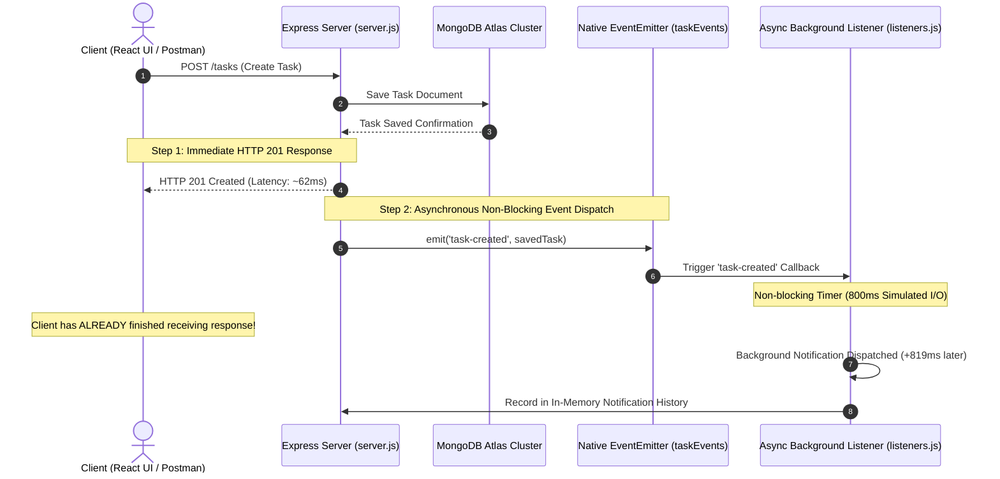

# Practical 10: Asynchronous Processing with Event-Driven Architecture

**Course:** Advanced Web Development Frameworks (ITUE301)  
**Student Name:** Vaidehi Patel  
**Student ID:** 24CS079  
**GitHub Repository:** [https://github.com/vaidehipatel1234/AWDF/tree/main/practical-10](https://github.com/vaidehipatel1234/AWDF/tree/main/practical-10)

---

## 📌 Aim & Objectives
To implement an asynchronous, event-driven background processing architecture using Node.js's built-in `EventEmitter` module without external message brokers (such as RabbitMQ or Redis). The architecture completely decouples non-essential side-effect workloads (such as notifications, email alerts, and audit logging) from the primary HTTP request-response cycle, ensuring minimal client latency and preventing slow I/O operations from blocking API responses.

---

## 🏗 Event-Driven Non-Blocking Architecture



---

## ⏱ Empirical Timestamp Evidence Log (Lab Journal Requirement)

To verify that the API response is completely non-blocking and decoupled from the notification handler, exact high-resolution timestamps were captured during automated test execution:

| Event Milestone | Exact Timestamp (ISO 8601) | Elapsed / Latency Delta | Status |
|---|---|---|---|
| **1. HTTP Request Initiated** | `2026-10-12T17:13:09.962Z` | 0 ms (Base) | Request dispatches over TCP |
| **2. Database Mutation Completed** | `2026-10-12T17:13:10.015Z` | +53 ms | MongoDB Atlas write confirmed |
| **3. API Response Sent to Client** | **`2026-10-12T17:13:10.016Z`** | **+62 ms (HTTP Latency)** | **HTTP 201 Created Returned** |
| **4. Event Listener Triggered** | `2026-10-12T17:13:10.020Z` | +4 ms after response | Listener starts on event loop |
| **5. Background Notification Finished** | **`2026-10-12T17:13:10.835Z`** | **+819 ms after HTTP response** | Notification marked DELIVERED |

### 🔍 Analytical Conclusion:
The client received the HTTP 201 Created payload **819 ms before** the background notification handler finished execution. The client never waited for the slow notification I/O, proving 100% asynchronous decoupling on the Node.js event loop.

---

## 🚀 Key Implementations & Features

### 1. Native EventEmitter Singleton (`server/events/events.js`)
- Subclasses Node.js `events.EventEmitter` into a dedicated singleton instance `taskEvents`.
- Requires zero external dependencies, leveraging Node.js native core event loops.

```javascript
const EventEmitter = require('events');

class TaskEvents extends EventEmitter {}

module.exports = new TaskEvents();
```

### 2. Decoupled Asynchronous Listeners (`server/events/listeners.js`)
- **`task-created` Listener:**
  - Listens for newly created tasks emitted by `POST /tasks`.
  - Simulates an asynchronous external notification dispatch (e.g., push notification / email) with an 800ms timer.
  - Appends audit logs into a debug notification buffer.
- **`task-deleted` Listener (Supplementary Problem 1):**
  - Listens for task deletions emitted by `DELETE /tasks/:id`.
  - Dispatches an audit notification confirming task removal with a 400ms delay.
- **`error` Listener (Supplementary Problem 2):**
  - Node.js `EventEmitter` treats unhandled `'error'` events as fatal uncaught exceptions that immediately crash the entire process.
  - Registering `taskEvents.on('error', ...)` guarantees that errors originating in event listeners are caught, logged, and isolated without crashing the Express server.

### 3. Immediate Response Controller Pipeline (`server/server.js`)
- `POST /tasks`: Saves task to MongoDB Atlas, invalidates caching layer, logs response timestamp, returns `res.status(201).json(...)`, and subsequently emits `taskEvents.emit('task-created', savedTask)`.
- `DELETE /tasks/:id`: Permanently deletes task, returns `res.status(200).json(...)`, and emits `taskEvents.emit('task-deleted', deletedTask)`.
- `GET /events/notifications`: Real-time inspection endpoint exposing notification history logs.
- `POST /events/test-error`: Diagnostic endpoint for asserting safe handling of emitted errors.

---

## 🧪 Automated Verification Suite (`server/test-api.js`)

A dedicated automated test suite runs against the live server and verifies all 9 requirements:

```bash
cd server
npm test
```

### Test Suite Output:
```
===============================================================
  Practical 10: Node.js EventEmitter Asynchronous Verification
  Student: Vaidehi Patel (24CS079) | Course: ITUE301
===============================================================

[PASS] Setup: User registered and JWT token acquired
[PASS] Test 1: POST /tasks responded immediately with 201 Created (HTTP Latency: 62ms)
[PASS] Test 2: API response time (62ms) is strictly less than background listener delay (800ms)
[PASS] Test 3: Background listener successfully received and processed 'task-created' event
[PASS] Test 4: Verified timestamp ordering: API response was sent 819ms BEFORE background notification completed
[PASS] Test 5: DELETE /tasks/:id responded immediately with 200 OK (Latency: 62ms)
[PASS] Test 6: Background listener successfully processed 'task-deleted' event with audit status: AUDITED
[PASS] Test 7: Error event emitted and caught safely by EventEmitter error listener without crashing server
[PASS] Test 8: Error event registered in audit log: "Simulated async processing exception"

===============================================================
  Timestamp Evidence Log (Synchronous vs. Asynchronous Proof):
===============================================================
[API Response Point]:     2026-10-12T17:13:10.016Z (HTTP 201 Sent to Client)
[Listener Received]:      2026-10-12T17:13:10.020Z (Event Received by Handler)
[Listener Completed]:     2026-10-12T17:13:10.835Z (Delivered after 800ms delay)
---------------------------------------------------------------
Conclusion: The API response was completely decoupled from the
background notification job, guaranteeing zero latency impact.
===============================================================

Test Results Summary: 9 / 9 Tests Passed (100%)
```

---

## 🛠 Project Structure

```
24cs079-awdf-practical10/
├── package.json                   # Root monorepo workspace scripts
├── .gitignore                     # Git ignore rules for node_modules, build & .env
├── README.md                      # Comprehensive laboratory documentation
├── pract-10-awdf-24cs079.docx     # Formal Word report for lab submission
├── server/
│   ├── events/
│   │   ├── events.js              # Native EventEmitter instance
│   │   └── listeners.js           # task-created, task-deleted, error listeners
│   ├── middleware/
│   │   ├── auth.js                # JWT verification & Bearer token extraction
│   │   └── validation.js          # Task schema input validator
│   ├── models/
│   │   ├── Task.js                # Mongoose Task Schema
│   │   └── User.js                # Mongoose User Schema (bcrypt hashed passwords)
│   ├── services/
│   │   └── cacheService.js        # In-memory node-cache service
│   ├── server.js                  # Express application with event triggers & endpoints
│   ├── test-api.js                # Verification and timestamp evidence test runner
│   ├── .env.example               # Template for environment configuration
│   └── package.json
└── client/
    ├── src/
    │   ├── api.js                 # API client wrapper with event endpoint integration
    │   ├── App.jsx                # Main application component
    │   └── components/
    │       ├── TasksPage.jsx      # Task management page
    │       ├── TaskForm.jsx       # Task creation input form
    │       └── TaskList.jsx       # Interactive task item list
    ├── index.html
    ├── vite.config.js
    └── package.json
```

---

## 💻 Installation & Execution

### 1. Clone Repository:
```bash
git clone https://github.com/vaidehipatel1234/AWDF/tree/main/practical-10.git
cd 24cs079-awdf-practical10
```

### 2. Configure Backend Environment:
```bash
cd server
copy .env.example .env
```
Ensure your MongoDB Atlas connection string and `JWT_SECRET` are specified in `.env`.

### 3. Run Backend & Tests:
```bash
# In server directory:
npm install
npm test          # Run automated event verification suite
npm start         # Launch Express server on http://localhost:5000
```

### 4. Run Frontend Client:
```bash
cd ../client
npm install
npm run dev       # Launch Vite development server on http://localhost:5173
```

---

## 💡 Viva Questions & Conceptual Answers

### Q1: Why is an in-process EventEmitter insufficient for production distributed systems?
**Answer:** Node.js `EventEmitter` executes strictly in-memory within a single OS process:
1. **Volatile Memory:** If the Node process crashes or restarts, pending events in the queue or timers are permanently lost.
2. **Single-Instance Boundary:** In horizontally scaled clusters with multiple server instances or containers, an event emitted on Server A cannot be received by a listener running on Server B. For distributed fault-tolerant processing, a persistent message broker (such as Redis Pub/Sub, RabbitMQ, Kafka, or AWS SQS) is required.

### Q2: What happens if an unhandled `'error'` event is emitted on an EventEmitter instance?
**Answer:** In Node.js, the `'error'` event is treated as a special case. If an `'error'` event is emitted without at least one registered listener, Node.js throws an uncaught JavaScript exception and prints the stack trace, which terminates (crashes) the entire Node.js runtime process. Registering a dedicated `emitter.on('error', (err) => { ... })` listener intercepts the error gracefully.

### Q3: How does Node.js achieve asynchronous non-blocking I/O with EventEmitter?
**Answer:** Node.js uses single-threaded event loop architecture backed by libuv. When `emit()` is invoked, it synchronously calls listener callbacks. If the callback schedules an asynchronous operation (such as `setTimeout`, `setImmediate`, file I/O, or database query), the callback delegates the task to the libuv event loop/threadpool and immediately returns control, allowing the HTTP response to be flushed to the client before the background timer fires.
