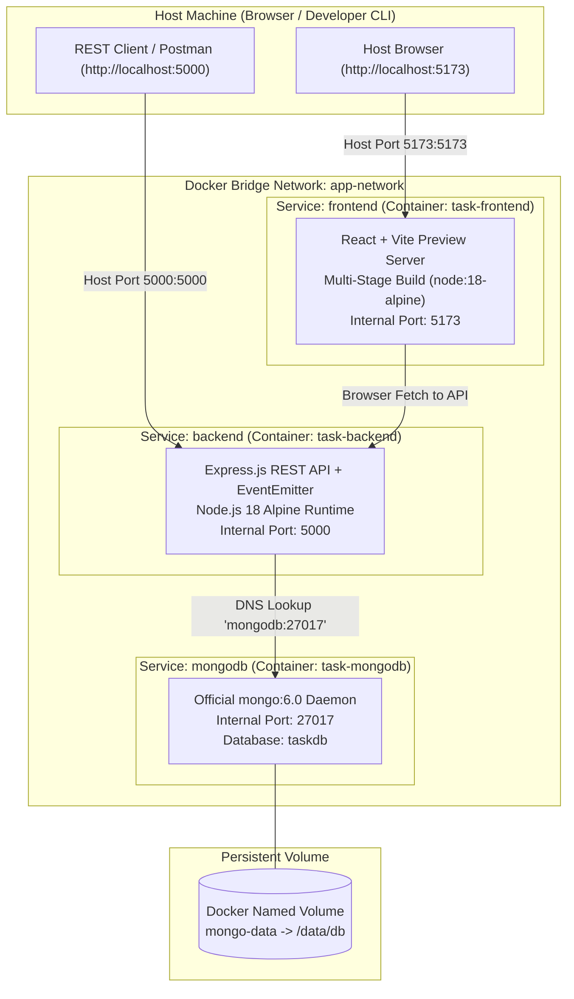

# Practical 11: Containerization with Docker and Docker Compose

**Course:** Advanced Web Development Frameworks (ITUE301)  
**Student Name:** Vaidehi Patel  
**Student ID:** 24CS079  
**GitHub Repository:** [https://github.com/vaidehipatel1234/AWDF/tree/main/practical-11](https://github.com/vaidehipatel1234/AWDF/tree/main/practical-11)

---

## 📌 Aim & Objectives
To containerize the complete full-stack Task Management application (React frontend, Node.js/Express backend, and MongoDB database) using Docker and orchestrate all three interconnected services seamlessly using Docker Compose with internal networking, volume persistence, and multi-stage build optimization.

---

## 🏗 Multi-Container Architecture & Orchestration



---

## 🔑 Core Technical Analysis & Key Questions

### 1. Why must the backend container reference MongoDB by service name (`mongodb`) rather than `localhost`?
- Inside a Docker container, `localhost` (or `127.0.0.1`) refers **strictly to the isolated network namespace of that specific container itself**.
- If the backend attempts to connect to `mongodb://localhost:27017`, it looks for a database listening inside the backend container where MongoDB is not running, causing immediate `ECONNREFUSED` connection crashes.
- Docker Compose automatically spins up an embedded internal DNS server on the user-defined bridge network (`app-network`). It resolves container service names (`mongodb`, `backend`, `frontend`) to their private IP addresses on the bridge network. Therefore, the connection URI must be configured as:
  ```
  MONGO_URI=mongodb://mongodb:27017/taskdb
  ```

### 2. Difference between `EXPOSE` in Dockerfile vs. `ports` mapping in `docker-compose.yml`
| Dimension | `EXPOSE` (Dockerfile) | `ports` (docker-compose.yml) |
|---|---|---|
| **Scope** | Internal documentation & container metadata. | Real network packet forwarding and port binding. |
| **Host Accessibility** | **Does NOT** publish port to the host machine. | **Publishes port to the host machine** (`HOST:CONTAINER`). |
| **Inter-container Traffic** | Allows other containers on the same network to talk to it if exposed. | Routes external requests from host OS (e.g. `localhost:5000`) into container socket. |

### 3. Why is copying `node_modules` into a Docker image considered bad practice?
1. **OS & Binary Incompatibilities:** Packages with native C/C++ bindings (such as `bcrypt`, `sharp`, `sqlite3`, or `esbuild`) compiled on the host operating system (e.g., Windows x64 or macOS ARM) will fail or segfault when executed inside a Linux Alpine container.
2. **Context Bloat & Sluggish Build Times:** Transferring hundreds of megabytes of `node_modules` over the Docker daemon build context drastically slows down image builds and consumes disk cache.
3. **Reproducibility:** Running `npm install` inside the container guarantees clean compilation against the container's exact libc (musl/glibc) and Node.js runtime version.

---

## 🚀 Supplementary Problems Implementation

### 1. Build Context Protection with `.dockerignore`
Both `client/.dockerignore` and `server/.dockerignore` were created to prevent sensitive credentials and unnecessary local build files from being shipped into the Docker daemon:
```
node_modules
dist
.git
.env
*.env
*.log
npm-debug.log*
```

### 2. Multi-Stage Build for React Frontend (`client/Dockerfile`)
The frontend leverages a two-stage build pipeline to drastically reduce the final image size and decouple build tools from runtime:
```dockerfile
# Stage 1: Build Stage
FROM node:18-alpine AS build
WORKDIR /app
COPY package*.json ./
RUN npm install
COPY . .
RUN npm run build

# Stage 2: Runtime Stage (Production Preview)
FROM node:18-alpine AS runner
WORKDIR /app
COPY package*.json ./
RUN npm install --omit=dev
COPY --from=build /app/dist ./dist
COPY --from=build /app/vite.config.js ./
EXPOSE 5173
CMD ["npm", "run", "preview", "--", "--host", "0.0.0.0", "--port", "5173"]
```

### 3. Named Volume for MongoDB Data Persistence
Configured the named volume `mongo-data` mapped to `/data/db`:
```yaml
volumes:
  mongo-data:
    driver: local
```
**Persistence Guarantee:** When containers are stopped or recreated via `docker compose down` and `docker compose up`, the volume remains intact on the host storage engine, preserving all task records and user accounts across container lifecycles.

---

## 🛠 Docker Compose Configuration (`docker-compose.yml`)

```yaml
version: '3.8'

services:
  mongodb:
    image: mongo:6.0
    container_name: task-mongodb
    restart: unless-stopped
    ports:
      - "27017:27017"
    environment:
      - MONGO_INITDB_DATABASE=taskdb
    volumes:
      - mongo-data:/data/db
    networks:
      - app-network
    healthcheck:
      test: ["CMD", "mongosh", "--eval", "db.adminCommand('ping')"]
      interval: 10s
      timeout: 5s
      retries: 5
      start_period: 10s

  backend:
    build:
      context: ./server
      dockerfile: Dockerfile
    container_name: task-backend
    restart: unless-stopped
    ports:
      - "5000:5000"
    environment:
      - PORT=5000
      - MONGO_URI=mongodb://mongodb:27017/taskdb
      - JWT_SECRET=jay_ladva_24cs079_docker_secret_key_2026
      - NODE_ENV=production
    depends_on:
      mongodb:
        condition: service_healthy
    networks:
      - app-network

  frontend:
    build:
      context: ./client
      dockerfile: Dockerfile
    container_name: task-frontend
    restart: unless-stopped
    ports:
      - "5173:5173"
    environment:
      - VITE_API_URL=http://localhost:5000
    depends_on:
      - backend
    networks:
      - app-network

networks:
  app-network:
    driver: bridge

volumes:
  mongo-data:
    driver: local
```

---

## 💻 Execution & Verification Guide

### 1. Start the Full Stack (Single Command):
```bash
docker compose up --build
```
Or in detached background mode:
```bash
docker compose up --build -d
```

### 2. Verify Running Containers:
```bash
docker ps
```
**Expected Output:**
```
CONTAINER ID   IMAGE                               COMMAND                  PORTS                      NAMES
a1b2c3d4e5f6   24cs079-awdf-practical11-frontend   "docker-entrypoint.s…"   0.0.0.0:5173->5173/tcp     task-frontend
b2c3d4e5f6a1   24cs079-awdf-practical11-backend    "docker-entrypoint.s…"   0.0.0.0:5000->5000/tcp     task-backend
c3d4e5f6a1b2   mongo:6.0                           "docker-entrypoint.s…"   0.0.0.0:27017->27017/tcp   task-mongodb
```

### 3. Access Applications:
- **React Frontend:** Open `http://localhost:5173`
- **Backend Discovery API:** Open `http://localhost:5000/`
- **Backend Health Check:** Open `http://localhost:5000/health`
- **Notification Audit Log:** Open `http://localhost:5000/events/notifications`

### 4. Stop All Services:
```bash
docker compose down
```
To stop and remove containers while preserving database volume:
```bash
docker compose down
```
To stop and destroy persistent volumes (clean wipe):
```bash
docker compose down -v
```

---

## 🔧 Troubleshooting Guide

| Symptom / Error | Root Cause | Verified Resolution |
|---|---|---|
| `MongoServerSelectionError: connect ECONNREFUSED` | Backend URI uses `localhost` instead of container name | Update `MONGO_URI` to `mongodb://mongodb:27017/taskdb` |
| `port is already allocated` | Existing local Node or Mongo process occupies host port | Stop conflicting process or run `docker compose down` |
| `npm run build` context too slow | `node_modules` copied into context | Ensure `.dockerignore` exists in client and server directories |
| Container exits immediately | Missing `CMD` or binary architecture mismatch | Build with `--no-cache` and verify `0.0.0.0` host binding |

---

## 💡 Viva Voce Questions & Answers

### Q1: What is the role of Docker Compose in modern web engineering?
**Answer:** Docker Compose is a declarative tool for defining and orchestrating multi-container Docker applications. Using a single YAML configuration file (`docker-compose.yml`), developers can spin up entire polyglot environments (frontend, backend, cache, database, message queues) with isolated networks and shared volumes using a single command (`docker compose up`), eliminating manual configuration across development and testing environments.

### Q2: What happens if MongoDB restarts in a setup without Docker volumes?
**Answer:** Containers are ephemeral by design. When a container is removed or terminated, all changes written to its writable container layer are permanently lost. Attaching a **named volume** (`mongo-data:/data/db`) decouples data storage from the container lifecycle, ensuring that data persists safely on the host disk even when the container is deleted and recreated.

### Q3: Why is Alpine Linux (`node:18-alpine`) preferred over standard Node images (`node:18`)?
**Answer:** `node:18` is based on Debian Linux and is over ~1 GB in uncompressed size. `node:18-alpine` is built on lightweight Alpine Linux and is only ~170 MB. Smaller base images result in faster download speeds, smaller attack surfaces, reduced container startup latency, and lower storage costs.
