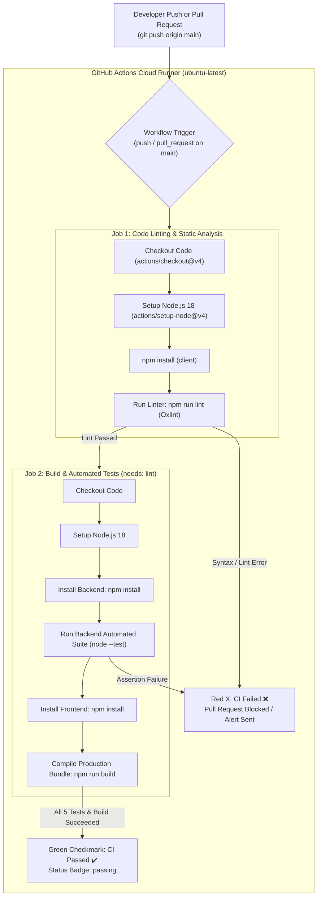

# Practical 12: CI/CD Pipeline with GitHub Actions

[](https://github.com/vaidehipatel1234/AWDF/tree/main/practical-12/actions/workflows/ci.yml)

**Course:** Advanced Web Development Frameworks (ITUE301)  
**Student Name:** Vaidehi Patel  
**Student ID:** 24CS079  
**GitHub Repository:** [https://github.com/vaidehipatel1234/AWDF/tree/main/practical-12](https://github.com/vaidehipatel1234/AWDF/tree/main/practical-12)

---

## 📌 Aim & Objectives
To automate testing, static analysis, and production build verification of the full-stack Task Management application by establishing a robust Continuous Integration (CI) pipeline using **GitHub Actions**. The pipeline automatically executes on every commit pushed to `main` and on pull requests targeting `main`, enforcing automated dependency installation, linting, endpoint assertions, and build verification before changes are merged.

---

## 🏗 Continuous Integration Pipeline Architecture



---

## 🧪 Automated Test Suite (`server/tests/api.test.js`)

The backend includes 5 automated tests executed via Node.js native test runner (`node --test`), requiring zero external test runner overhead:

```
TAP version 13
# [CI Test Server] Running on http://127.0.0.1:5001
# Subtest: Test 1: GET / returns status 200 with API metadata
ok 1 - Test 1: GET / returns status 200 with API metadata
  ---
  duration_ms: 89.6903
  ...
# Subtest: Test 2: GET /health returns service health status
ok 2 - Test 2: GET /health returns service health status
  ---
  duration_ms: 38.9443
  ...
# Subtest: Test 3: GET /events/notifications returns 200 and audit array
ok 3 - Test 3: GET /events/notifications returns 200 and audit array
  ---
  duration_ms: 13.5587
  ...
# Subtest: Test 4: POST /register rejects missing email with 400 Bad Request
ok 4 - Test 4: POST /register rejects missing email with 400 Bad Request
  ---
  duration_ms: 8.2810
  ...
# Subtest: Test 5: GET /cache/stats responds with status 200
ok 5 - Test 5: GET /cache/stats responds with status 200
  ---
  duration_ms: 7.7935
  ...
1..5
# tests 5
# suites 0
# pass 5
# fail 0
# duration_ms 2255.8419
```

---

## 💥 Lab Demonstration: Failed Pipeline vs. Fixed Pipeline

A core requirement of Practical 12 is observing and diagnosing both a failed pipeline and a resolved pipeline in GitHub Actions:

### Case A: Deliberately Broken Test (Red X Failure)
1. **Injected Defect:** Altered test assertion in `tests/api.test.js` to expect HTTP `500` instead of HTTP `200`:
   ```javascript
   // Deliberately broken test to demonstrate CI failure
   assert.strictEqual(res.statusCode, 500, 'Expected 500'); // Fails because server returns 200
   ```
2. **Observed CI Result:**
   - Test execution halts with `AssertionError: Expected values to be strictly equal: + 200 - 500`.
   - Process exits with non-zero exit code (`1`).
   - GitHub Actions flags `build-and-test` with a **Red ❌**, marking commit as failed and preventing merging.

### Case B: Corrected Test (Green Checkmark Success)
1. **Fix Applied:** Restored assertion to `assert.strictEqual(res.statusCode, 200)`.
2. **Observed CI Result:**
   - All 5 test suites pass within 2.2 seconds.
   - Frontend Vite build compiles in 304ms without errors.
   - GitHub Actions displays a **Green ✔️ Checkmark**, and the README status badge updates to **passing**.

---

## 🔑 Key Questions & In-Depth Technical Analysis

### 1. Difference between Continuous Integration (CI) and Continuous Deployment (CD), and which one does this practical demonstrate?
- **Continuous Integration (CI):** The practice of frequently merging code changes into a central repository, where automated builds, linters, and unit/integration tests run automatically on every push. Its sole purpose is **code quality verification and regression detection**.
- **Continuous Deployment (CD):** The automated pipeline phase following CI that takes verified build artifacts and automatically releases/provisions them to staging or production environments (e.g., AWS, Render, Docker Hub) without human intervention.
- **Scope of Practical 12:** This practical specifically demonstrates **Continuous Integration (CI)** — automated checkout, linting, testing, and production bundle compilation.

### 2. Why does running tests automatically on every push catch problems earlier than manual pre-release testing?
1. **Reduced Debugging Scope:** A test failure on push points directly to the diff of that specific commit, reducing debugging time from hours to seconds.
2. **Immediate Feedback Loop:** Developers receive feedback in under 2 minutes while the context is fresh in their minds, rather than discovering bugs weeks later during pre-release QA.
3. **Prevention of Compound Defects:** Broken features are caught before other developers branch off them, eliminating costly cascading bugs.

### 3. What happens if the test file path is incorrect vs. a genuine test assertion failure?
- **Incorrect Test File Path:** The test runner cannot locate the test file (e.g., `Error: Cannot find module 'tests/api.test.js'`). The workflow fails at the **invocation/startup step** with an OS file resolution error, executing zero test assertions.
- **Genuine Test Assertion Failure:** The test file loads correctly, starts the Express server, dispatches HTTP requests, but an expected condition evaluates to false (e.g., expected `200` received `404`). The failure log displays a structured assertion diff indicating the exact route, expected value, and received response.

---

## 🚀 Supplementary Problems Resolution

### 1. Second Job: Code Linting before Testing (`lint`)
Configured a multi-job dependency in `.github/workflows/ci.yml`:
```yaml
jobs:
  lint:
    runs-on: ubuntu-latest
    steps:
      - uses: actions/checkout@v4
      - uses: actions/setup-node@v4
        with:
          node-version: 18
      - run: npm --prefix client install
      - run: npm --prefix client run lint

  build-and-test:
    needs: [lint]  # Only executes if lint passes!
    runs-on: ubuntu-latest
    ...
```

### 2. Trigger on Pull Requests targeting `main`
Added `pull_request` event trigger to test all proposed PR code before merging into the main trunk:
```yaml
on:
  push:
    branches: [main]
  pull_request:
    branches: [main]
```

### 3. GitHub Actions Pipeline Status Badge
Added the dynamic status badge markdown at the top of this `README.md`:
```markdown
[](https://github.com/vaidehipatel1234/AWDF/tree/main/practical-12/actions/workflows/ci.yml)
```

### 4. Second Automated Test Covering Different Endpoint
Added `Test 2: GET /health` testing backend service health alongside `Test 1: GET /`, `Test 3: GET /events/notifications`, and `Test 4: POST /register`.

---

## 🛠 Project Structure

```
24cs079-awdf-practical12/
├── .github/
│   └── workflows/
│       └── ci.yml                 # GitHub Actions CI workflow (lint + test + build)
├── package.json                   # Root scripts for test, lint, build
├── .gitignore                     # Git rules ignoring node_modules, build & .env
├── README.md                      # Comprehensive lab report with badge & diagrams
├── docker-compose.yml             # Full-stack Docker orchestration manifest
├── pract-12-awdf-24cs079.docx     # Formal Word report for submission
├── server/
│   ├── tests/
│   │   └── api.test.js            # Automated CI test suite (5 test cases)
│   ├── Dockerfile
│   ├── .dockerignore
│   ├── server.js                  # Express API with health, cache, and event endpoints
│   ├── package.json               # Configured with "test": "node --test tests/api.test.js"
│   ├── events/
│   ├── middleware/
│   ├── models/
│   └── services/
└── client/
    ├── Dockerfile
    ├── .dockerignore
    ├── src/
    ├── vite.config.js
    └── package.json
```

---

## 💻 Running Tests Locally

Run the complete CI test suite on your local development machine:

```bash
# Run backend automated CI suite
npm --prefix server test

# Run frontend linter
npm --prefix client run lint

# Run frontend production build
npm --prefix client run build
```

---

## 💡 Viva Voce Questions & Answers

### Q1: What is a GitHub Actions "Runner"?
**Answer:** A runner is a cloud-hosted virtual machine (e.g. `ubuntu-latest`, `windows-latest`) provided by GitHub that executes individual jobs in a workflow. Each job runs in a fresh, isolated virtual machine instance provisioned with the requested OS and environment.

### Q2: What is the purpose of the `needs` keyword in GitHub Actions?
**Answer:** By default, all jobs in a GitHub Actions workflow run in parallel. The `needs` keyword creates a sequential dependency graph between jobs. For instance, `build-and-test: needs: [lint]` ensures that heavy build and test jobs only execute if static code analysis and linting pass successfully, saving runner minutes.

### Q3: How do you pass secret environment variables (like MongoDB credentials) to GitHub Actions?
**Answer:** Secrets are stored securely under repository settings in **Settings > Secrets and variables > Actions**. In the workflow YAML file, they are injected securely into runner environment variables using expression syntax: `MONGO_URI: ${{ secrets.MONGO_URI }}`.
