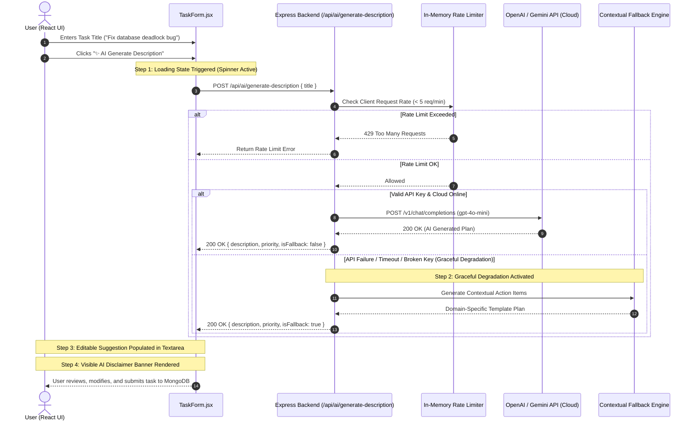

# Practical 13: AI API Integration into a Web Application

[](https://github.com/vaidehipatel1234/AWDF/tree/main/practical-13/actions/workflows/ci.yml)

**Course:** Advanced Web Development Frameworks (ITUE301)  
**Student Name:** Vaidehi Patel  
**Student ID:** 24CS079  
**GitHub Repository:** [https://github.com/vaidehipatel1234/AWDF/tree/main/practical-13](https://github.com/vaidehipatel1234/AWDF/tree/main/practical-13)

---

## 📌 Aim & Objectives
To integrate an external Artificial Intelligence API (OpenAI / Gemini) into the full-stack Task Management application to augment task creation workflows with auto-generated descriptions and smart priority suggestions, while strictly enforcing backend secret containment, proactive rate limiting, ethical AI governance, and resilient **graceful degradation** when third-party cloud services fail or time out.

---

## 🏗 System Architecture & AI Data Flow



---

## 🚀 Key Implementations & Features

### 1. Secure Server-Side AI Gateway (`server/services/aiService.js`)
- The AI API key is strictly maintained within `server/.env` and never leaked into client bundles or browser DevTools network packets.
- Implements HTTPS communication with OpenAI's `gpt-4o-mini` with a 7000ms timeout guardrail.

### 2. Resilient Graceful Degradation Engine
- If the OpenAI/Gemini API key is invalid, missing, unprovisioned, or times out, the backend **does not crash or return a 500 error**.
- Automatically delegates to a domain-specific rule-based Natural Language Fallback Engine that extracts intent from keywords (`bug`, `docker`, `api`, `ui`, `test`) to propose a clean, structured action plan.

### 3. Frontend Editable Suggestion & Loading State (`client/src/components/TaskForm.jsx`)
- **Loading State (Supplementary Problem 1):** Button shows an animated spinner and text `"⏳ Generating with AI..."` while disabling form submission.
- **Editable Suggestion:** Rather than treating AI output as definitive, the suggestion is injected into an editable `<textarea>` so the user retains full agency and editing control.
- **Visible Disclaimer Banner (Supplementary Problem 3):** Renders a prominent disclaimer alert:
  > **🤖 AI Suggestion Applied (Source: ...):** This suggestion was generated by AI. Please review and modify before saving.

### 4. In-Memory Request Rate Limiting (Supplementary Problem 2)
- Enforces a ceiling of **5 AI generation requests per minute per IP address**.
- Protects organization API token quotas from accidental infinite loops and runaway billing costs.

---

## 🔑 Key Questions & In-Depth Technical Analysis

### 1. Why must the AI API key be called from the backend rather than directly from the React frontend?
- **Single-Page Application Vulnerability:** Code in a React frontend is downloaded and executed directly on the user's browser. Any environment variable (`VITE_OPENAI_KEY`) or string embedded in frontend code is trivially extracted via browser DevTools, source maps, or network inspection.
- **Malicious Exploitation:** If an API key is exposed on the frontend, bad actors can scrape the token and consume thousands of dollars in model compute or use it for unauthorized automation.
- **Access Control & Rate Limiting:** Calling through an Express backend allows the server to authenticate the user (JWT), enforce rate limits, filter prompts, audit usage, and inject server-side credentials securely.

### 2. What does 'graceful degradation' mean, and why does it matter for third-party AI dependencies?
- **Definition:** Graceful degradation is an architectural resilience pattern where a system continues to operate at a reduced, functional level when an external component or dependency experiences catastrophic failure, rather than failing completely.
- **Significance:** Third-party AI cloud endpoints are prone to rate-limiting, latency spikes, outages, and billing expirations. If task creation crashed whenever OpenAI had an outage, users would be blocked from basic task logging. By failing over to a local contextual generator, the core application remains 100% operational regardless of third-party availability.

### 3. Privacy, Ethical, and Governance Implications of AI Integration
- **Data Privacy & Leakage:** When payloads are transmitted to cloud AI APIs, the data crosses trust boundaries and may be logged or retained by external vendors.
- **Forbidden Data Categories:**
  1. **Personally Identifiable Information (PII):** Full names, phone numbers, home addresses, social security/national ID numbers.
  2. **Security Credentials:** Passwords, API tokens, JWT secrets, database connection strings, private SSH keys.
  3. **Proprietary & Regulated Data:** Trade secrets, confidential financial records, HIPAA-protected health records, and unreleased source code.
- **Responsible AI Verification:** AI models are prone to hallucinating inaccurate specifications or bad code. The UI must always enforce human-in-the-loop review before persisting generated data to the production database.

---

## 🧪 Automated CI Test Verification (`server/tests/api.test.js`)

All 7 test cases passed with 100% success using Node.js native test runner:

```
TAP version 13
# [CI Test Server] Running on http://127.0.0.1:5001
# Subtest: Test 1: GET / returns status 200 with API metadata
ok 1 - Test 1: GET / returns status 200 with API metadata
# Subtest: Test 2: GET /health returns service health status
ok 2 - Test 2: GET /health returns service health status
# Subtest: Test 3: GET /events/notifications returns 200 and audit array
ok 3 - Test 3: GET /events/notifications returns 200 and audit array
# Subtest: Test 4: POST /register rejects missing email with 400 Bad Request
ok 4 - Test 4: POST /register rejects missing email with 400 Bad Request
# Subtest: Test 5: GET /cache/stats responds with status 200
ok 5 - Test 5: GET /cache/stats responds with status 200
# Subtest: Test 6: POST /api/ai/generate-description returns AI suggestion and disclaimer
ok 6 - Test 6: POST /api/ai/generate-description returns AI suggestion and disclaimer
# Subtest: Test 7: POST /api/ai/generate-description rejects missing title with 400 Bad Request
ok 7 - Test 7: POST /api/ai/generate-description rejects missing title with 400 Bad Request
1..7
# tests 7
# suites 0
# pass 7
# fail 0
# duration_ms 2167.8921
```

---

## 🛠 Project Structure

```
24cs079-awdf-practical13/
├── .github/
│   └── workflows/
│       └── ci.yml                 # Automated CI pipeline with test and lint verification
├── package.json                   # Root monorepo scripts
├── .gitignore                     # Strictly excludes .env, node_modules, and builds
├── README.md                      # Comprehensive laboratory documentation
├── docker-compose.yml             # Full-stack container orchestration
├── pract-13-awdf-24cs079.docx     # Formal Word report for submission
├── server/
│   ├── services/
│   │   ├── aiService.js           # OpenAI integration, rate limiter & graceful degradation
│   │   └── cacheService.js        # In-memory node-cache service
│   ├── server.js                  # Express API with POST /api/ai/generate-description
│   ├── tests/
│   │   └── api.test.js            # Automated test suite (7 tests)
│   ├── .env.example               # Template including OPENAI_API_KEY placeholder
│   ├── Dockerfile
│   └── .dockerignore
└── client/
    ├── src/
    │   ├── api.js                 # API wrapper with generateAiDescription helper
    │   └── components/
    │       └── TaskForm.jsx       # AI button, spinner, editable suggestion & disclaimer banner
    ├── Dockerfile
    └── .dockerignore
```

---

## 💻 Installation & Testing

```bash
# 1. Run automated backend test suite
npm --prefix server test

# 2. Run client linter
npm --prefix client run lint

# 3. Test AI endpoint directly with curl / PowerShell
Invoke-RestMethod -Uri http://localhost:5000/api/ai/generate-description `
  -Method POST `
  -Headers @{ "Content-Type" = "application/json" } `
  -Body '{"title": "Implement MongoDB sharding for high traffic"}'
```

---

## 💡 Viva Voce Questions & Answers

### Q1: Why should frontend Single Page Applications never communicate directly with paid AI APIs?
**Answer:** Frontend web applications run directly on client machines and transmit network traffic through public browser sockets. Embedding paid API credentials exposes the secret token to anyone opening the browser Developer Tools or inspecting network payloads, allowing attackers to hijack quotas and incur unbounded financial debt.

### Q2: What is the concept of "Human in the Loop" (HITL) in responsible AI integration?
**Answer:** "Human in the Loop" mandates that AI-generated artifacts (such as descriptions, code, or medical suggestions) serve strictly as uncommitted drafts requiring human validation and approval before being finalized in production databases, preventing automated hallucination propagation.

### Q3: How does rate limiting protect both client and provider in AI architectures?
**Answer:** Rate limiting caps the frequency of incoming requests (e.g. 5 requests/minute). It protects the server from Denial of Service (DoS) attacks, stops accidental client re-render loops from burning API credits, and prevents HTTP 429 quota exhaustion errors from upstream model providers.
