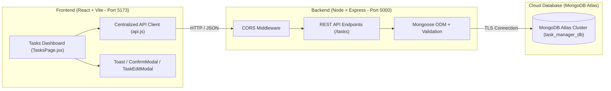

# Practical 6: Full Stack Integration (React + Node.js + MongoDB Atlas)

**Course:** Advanced Web Development Frameworks (ITUE301)  
**Student Name:** Vaidehi Patel  
**Student ID:** 24CS079  
**GitHub Repository:** [https://github.com/vaidehipatel1234/AWDF/tree/main/practical-6](https://github.com/vaidehipatel1234/AWDF/tree/main/practical-6)

---

## 📌 Aim
To wire the React frontend with the Node.js/Express and MongoDB Atlas backend into a fully integrated, robust full-stack web application with complete CRUD operations, optimistic UI updates, confirmation modals, and toast notifications.

---

## 🏗 System Architecture



---

## 🚀 Key Features & Implementation Highlights

1. **Full-Stack End-to-End CRUD:**
   - **Create:** Add tasks with title, description, and priority (`low`, `medium`, `high`).
   - **Read:** Fetch all tasks on component mount with loading indicators and error diagnostics.
   - **Update:** Inline/modal edit for task title, description, and status; fast toggle for completion state.
   - **Delete:** Remove tasks cleanly from MongoDB Atlas with state cleanup.

2. **CORS Configuration:**
   - Express server explicitly enables cross-origin requests from `http://localhost:5173` with credentials and allowed headers.

3. **Supplementary Problem 1: Optimistic UI Updates:**
   - User can enable or disable Optimistic UI via a live toggle button.
   - When enabled, new tasks immediately render in the list with a temporary ID and pending badge, reconciling seamlessly with the database response.
   - If server creation fails, the optimistic task is automatically rolled back with an error notification.

4. **Supplementary Problem 2: Delete Confirmation Modal:**
   - Built custom `ConfirmModal.jsx` to eliminate abrupt browser `window.confirm()` dialogs.
   - Shows the exact task title with danger confirmation and cancel options.

5. **Supplementary Problem 3: Toast Notification Component:**
   - Built reusable `Toast.jsx` supporting `success`, `error`, and `info` types.
   - Displays real-time operation status (e.g. "Task created successfully", "Status updated", "Connection error") and automatically dismisses after 3.5 seconds.

6. **Search & Filter:**
   - Instant filtering by status (`All`, `Pending`, `Completed`).
   - Real-time search query filtering across task titles and descriptions.

---

## 📁 Repository Structure

```
24cs079-awdf-practical6/
├── client/                     # Frontend Application (React + Vite)
│   ├── public/
│   ├── src/
│   │   ├── api.js              # Centralized API service layer (fetch client)
│   │   ├── components/
│   │   │   ├── ConfirmModal.jsx    # Custom delete confirmation dialog
│   │   │   ├── TaskEditModal.jsx   # Inline task editor modal
│   │   │   ├── TaskForm.jsx        # Task creation form
│   │   │   ├── TaskList.jsx        # Responsive task card grid
│   │   │   ├── TasksPage.jsx       # Main full-stack tasks view
│   │   │   └── Toast.jsx           # Success/error toast notification banner
│   │   ├── App.jsx             # React router & global shell
│   │   ├── App.css             # Modern dark-mode styles & animations
│   │   └── main.jsx
│   ├── package.json
│   └── vite.config.js
│
├── server/                     # Backend Application (Node.js + Express + Mongoose)
│   ├── models/
│   │   └── Task.js             # Mongoose Schema & validation hooks
│   ├── .env.example            # Environment variable template
│   ├── server.js               # Express REST API with CORS and routes
│   ├── test-api.js             # Automated 14-step integration test suite
│   └── package.json
│
├── .gitignore                  # Global ignore (safeguards secrets & node_modules)
├── package.json                # Root monorepo scripts
└── README.md                   # Project documentation
```

---

## 🛠 Setup & Running Locally

### Prerequisites
- Node.js (v18+) & npm
- Active Internet connection (for MongoDB Atlas)

### 1. Backend Server Setup
```bash
cd server
npm install

# Copy .env.example to .env and configure your connection string
cp .env.example .env

# Start the server (Port 5000)
npm start
```
> The server will connect to MongoDB Atlas and listen on `http://localhost:5000`.

### 2. Frontend Client Setup
```bash
cd client
npm install

# Start Vite development server (Port 5173)
npm run dev
```
> Open your browser and navigate to `http://localhost:5173/tasks`.

### 3. Running Automated Integration Tests
```bash
cd server
npm test
```
> Runs 14 comprehensive automated integration tests against MongoDB Atlas covering CRUD operations, ObjectId validation, header validation, and error states.

---

## 📡 REST API Reference

| Method | Endpoint | Description | Request Body | Status Codes |
|---|---|---|---|---|
| `GET` | `/tasks` | Retrieve all tasks | None | 200, 500 |
| `GET` | `/tasks/:id` | Retrieve task by ID | None | 200, 400, 404 |
| `POST` | `/tasks` | Create a new task | `{ title, description, priority, completed }` | 201, 400 |
| `PUT` | `/tasks/:id` | Update existing task | `{ title, description, priority, completed }` | 200, 400, 404 |
| `DELETE` | `/tasks/:id` | Delete a task | None | 200, 400, 404 |

---

## 👨‍💻 Author
**Vaidehi Patel (24CS079)**  
Department of Computer Science & Engineering
