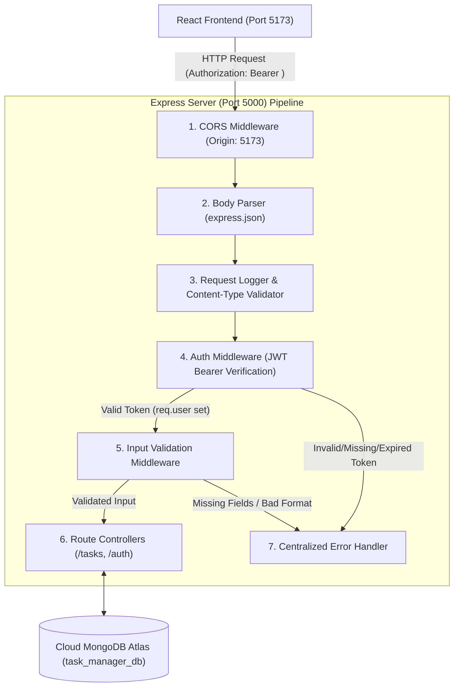

# Practical 7: Authentication and Middleware Pipeline

**Course:** Advanced Web Development Frameworks (ITUE301)  
**Student Name:** Vaidehi Patel  
**Student ID:** 24CS079  
**GitHub Repository:** [https://github.com/vaidehipatel1234/AWDF/tree/main/practical-7](https://github.com/vaidehipatel1234/AWDF/tree/main/practical-7)

---

## 📌 Aim & Objectives
To implement secure JWT-based authentication, bcrypt password hashing, and a robust server-side input validation middleware pipeline as part of the Express request processing workflow, protecting all task CRUD operations and integrating seamlessly with a React frontend and MongoDB Atlas cloud database.

---

## 🏗 System Architecture & Middleware Pipeline



---

## 🚀 Key Features & Implementation Highlights

1. **Password Hashing with bcryptjs:**
   - User passwords are automatically salted and hashed using `bcryptjs` with a cost factor of `10` before persisting into MongoDB Atlas.
   - Plaintext passwords are never stored in the database or logged in responses.

2. **JWT Generation & Verification:**
   - Upon successful registration or login, an HMAC SHA-256 JWT token is signed using `process.env.JWT_SECRET` with a 1-hour expiration time (`expiresIn: '1h'`).
   - The token contains the authenticated user's ID and email in its payload.

3. **Authentication Middleware (`middleware/auth.js`):**
   - Intercepts requests to protected routes and verifies the `Authorization: Bearer <token>` header.
   - Decodes the token using `jwt.verify()` safely inside a `try/catch` block.
   - Handles missing tokens, malformed headers, and expired tokens gracefully by returning `401 Unauthorized` without crashing the server.
   - Sets `req.user` on the request object for subsequent controllers.

4. **Input Validation Middleware Pipeline (`middleware/validate.js`):**
   - `validateRegister`: Validates email syntax using regex and enforces a minimum password length of 6 characters.
   - `validateLogin`: Ensures both email and password are provided before database queries.
   - `validateTask`: Enforces mandatory, non-empty `title` and validates priority enums (`low`, `medium`, `high`).
   - `validateObjectId`: Rejects malformed IDs before database operations.

5. **Supplementary Problem 1: `/me` Profile Endpoint:**
   - Implemented `GET /me` (protected with `authMiddleware`) which decodes the JWT and returns the logged-in user's profile details (`id`, `email`, `name`, `createdAt`) excluding the password.

6. **Supplementary Problem 2: Frontend 401 Token Expiry Handling:**
   - Centralized `authFetch` wrapper in `client/src/api.js` intercepts `401 Unauthorized` responses.
   - Automatically purges expired credentials from `localStorage`, dispatches `auth:unauthorized` event, displays a warning toast, and redirects the user to the login dialog.

7. **Client Logout Mechanism:**
   - Integrated a clean logout button in the navigation bar and task dashboard.
   - Purges JWT and user metadata from `localStorage` and resets authenticated state.

---

## 📁 Repository Structure

```
24cs079-awdf-practical7/
├── client/                         # Frontend Application (React 18 + Vite)
│   ├── public/
│   ├── src/
│   │   ├── api.js                  # Centralized API service with JWT injection & 401 interceptor
│   │   ├── components/
│   │   │   ├── AuthModal.jsx       # Login & Register modal dialog with quick-fill demo
│   │   │   ├── ConfirmModal.jsx    # Custom delete confirmation dialog
│   │   │   ├── TaskEditModal.jsx   # In-place task title/desc/status editor
│   │   │   ├── TaskForm.jsx        # Task creation form with priority selector
│   │   │   ├── TaskList.jsx        # Responsive task card grid
│   │   │   ├── TasksPage.jsx       # Full-stack tasks dashboard (Auth status & CRUD)
│   │   │   ├── Toast.jsx           # Auto-dismissing toast notifications
│   │   │   └── NavBar.jsx          # Top navigation with user badge & logout button
│   │   ├── App.jsx                 # App root with auth state & token expiry listener
│   │   ├── App.css                 # Modern styles & glassmorphic theme
│   │   └── main.jsx
│   ├── package.json
│   └── vite.config.js
│
├── server/                         # Backend Application (Node.js + Express + Mongoose)
│   ├── middleware/
│   │   ├── auth.js                 # JWT verification middleware
│   │   └── validate.js             # Input validation pipeline middleware
│   ├── models/
│   │   ├── Task.js                 # Task schema with user reference & pre-save hook
│   │   └── User.js                 # User schema with email & hashed password
│   ├── .env.example                # Template with placeholder credentials
│   ├── server.js                   # Express server with auth & protected routes
│   ├── test-api.js                 # 16-step automated test suite
│   └── package.json
│
├── .gitignore                      # Safeguards secrets (.env) and node_modules
├── package.json                    # Root monorepo workspace scripts
└── README.md                       # Comprehensive documentation
```

---

## 🛠 Setup & Running Locally

### Prerequisites
- Node.js (v18+) & npm
- Active Internet connection (for MongoDB Atlas cloud cluster)

### 1. Backend Server Setup
```bash
cd server
npm install

# Copy .env.example to .env and configure your variables
cp .env.example .env

# Start the server (Port 5000)
npm start
```
> The server will connect to MongoDB Atlas and listen on `http://localhost:5000`.

### 2. Frontend Client Setup
```bash
cd client
npm install

# Start Vite development server (Port 5173)
npm run dev
```
> Open your browser and navigate to `http://localhost:5173/tasks`.

### 3. Running Automated Integration Tests
```bash
cd server
npm test
```
> Runs 16 automated end-to-end integration tests validating JWT generation, password verification, route protection, 401 handling, input validation, and MongoDB Atlas persistence.

---

## 📡 REST API Reference

| Method | Endpoint | Access | Description | Request Body | Status Codes |
|---|---|---|---|---|---|
| `POST` | `/register` | Public | Register new user with bcrypt hash | `{ email, password, name? }` | 201, 400 |
| `POST` | `/login` | Public | Authenticate user and issue JWT | `{ email, password }` | 200, 401 |
| `GET` | `/me` | Protected | Get logged-in user profile | None (Bearer token) | 200, 401, 404 |
| `GET` | `/tasks` | Protected | Fetch tasks for authenticated user | None (Bearer token) | 200, 401 |
| `GET` | `/tasks/:id` | Protected | Fetch task by ID | None (Bearer token) | 200, 400, 401, 404 |
| `POST` | `/tasks` | Protected | Create new task (validated) | `{ title, description?, priority? }` | 201, 400, 401 |
| `PUT` | `/tasks/:id` | Protected | Update task by ID | `{ title?, description?, completed?, priority? }` | 200, 400, 401, 404 |
| `DELETE` | `/tasks/:id` | Protected | Delete task by ID | None (Bearer token) | 200, 400, 401, 404 |

---

## 👨‍💻 Author
**Vaidehi Patel (24CS079)**  
Department of Computer Science & Engineering
