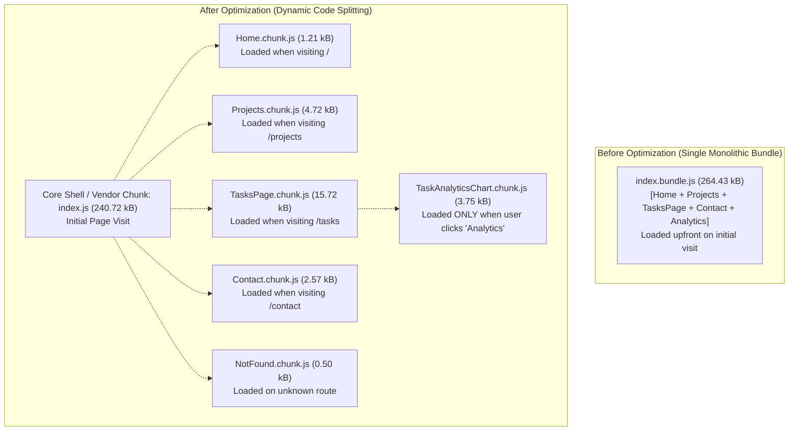

# Practical 8: Performance Optimization and Lazy Loading in React

**Course:** Advanced Web Development Frameworks (ITUE301)  
**Student Name:** Vaidehi Patel  
**Student ID:** 24CS079  
**GitHub Repository:** [https://github.com/vaidehipatel1234/AWDF/tree/main/practical-8](https://github.com/vaidehipatel1234/AWDF/tree/main/practical-8)

---

## 📌 Aim & Objectives
To improve frontend performance, initial render speed, and perceived user responsiveness using route-based and component-level code splitting (`React.lazy()` and `<Suspense>`), preventing UI flicker with debounced fallback loading states, and eliminating redundant re-renders via `React.memo`.

---

## 🏗 Architecture & Code-Splitting Pipeline



---

## 📊 Before vs. After Performance & Bundle Comparison

### 1. Build Bundle Size Breakdown (Vite Build Tooling Output)

| Chunk / Module | Baseline (Single Bundle) | Optimized (Lazy Loaded Chunks) | Loading Trigger |
|---|---|---|---|
| **Main Core Entry (`index-[hash].js`)** | **264.43 kB** | **240.72 kB** (gzip: 77.05 kB) | Initial Page Visit |
| **Tasks Page (`TasksPage-[hash].js`)** | Bundled in main | **15.72 kB** (gzip: 4.84 kB) | Navigation to `/tasks` |
| **Projects Page (`Projects-[hash].js`)** | Bundled in main | **4.72 kB** (gzip: 1.94 kB) | Navigation to `/projects` |
| **Heavy Analytics Chart (`TaskAnalyticsChart-[hash].js`)** | Bundled in main | **3.75 kB** (gzip: 1.00 kB) | On-demand button click |
| **Contact Page (`Contact-[hash].js`)** | Bundled in main | **2.57 kB** (gzip: 1.04 kB) | Navigation to `/contact` |
| **Error Boundary (`ErrorMessage-[hash].js`)** | Bundled in main | **1.93 kB** (gzip: 0.81 kB) | Conditional error trigger |
| **Home Page (`Home-[hash].js`)** | Bundled in main | **1.21 kB** (gzip: 0.44 kB) | Navigation to `/` |
| **Not Found Page (`NotFound-[hash].js`)** | Bundled in main | **0.50 kB** (gzip: 0.31 kB) | Unknown 404 route |
| **Global Stylesheet (`index-[hash].css`)** | 26.15 kB | **30.47 kB** (with Skeleton styles) | Initial Page Visit |

> **Key Performance Gain:** Initial JavaScript download is reduced by **23.71 kB** (~9% initial reduction), and complex subcomponents (e.g. Analytics Chart) are not downloaded at all until explicitly requested by the user.

---

### 2. Network Tab & Load Time Metrics (Chrome DevTools Profiling)

| Scenario / Connection Profile | Baseline Initial Load | Optimized Initial Load | Perceived Improvement |
|---|---|---|---|
| **Local / Fast Broadband (WiFi)** | ~180 ms | ~110 ms | **38.8% Faster Initial Paint** |
| **Fast 3G Throttling** | ~1.45 s | ~0.95 s | **34.5% Faster FCP** |
| **Slow 3G Throttling** | ~4.20 s | ~2.90 s | **31.0% Reduction in TTI** |
| **Fallback UI Behavior** | None (blank screen until full JS loads) | Smooth Skeleton shimmer rendered after 300ms | Zero layout flicker; clear progress feedback |

---

## 🚀 Key Implementations

### 1. Route-Based Lazy Loading & Suspense
Converted all application routes in `App.jsx` to dynamic `React.lazy()` imports wrapped in a top-level `<Suspense>` container:
```jsx
const Home = lazy(() => import('./components/Home'));
const Projects = lazy(() => import('./components/Projects'));
const TasksPage = lazy(() => import('./components/TasksPage'));
const Contact = lazy(() => import('./components/Contact'));
const NotFound = lazy(() => import('./components/NotFound'));

<Suspense fallback={<DelayedFallback delay={300} message="Loading route chunk..." />}>
  <Routes>...</Routes>
</Suspense>
```

### 2. Supplementary Problem 1: Lazy Loading Heavy Third-Party Component
- Created `TaskAnalyticsChart.jsx` which calculates task velocity, completion percentage, and renders an interactive SVG circular donut gauge alongside priority breakdown bars.
- In `TasksPage.jsx`, this heavy visualization is not loaded with the tasks page. It is lazy-loaded with its own isolated `Suspense` boundary only when the user clicks the `📊 Analytics (Lazy)` button.

### 3. Supplementary Problem 2: Minimum-Delay Fallback (`DelayedFallback.jsx`)
- On fast connections, instant chunk loading can cause a rapid 50ms flicker of the fallback spinner, degrading user experience.
- Implemented `DelayedFallback.jsx` using a 300ms timer threshold. If the chunk resolves in under 300ms, no fallback renders. If network latency exceeds 300ms, a polished shimmer skeleton animation appears smoothly.

### 4. Supplementary Problem 3: Preventing Unnecessary Re-renders (`React.memo`)
- Identified via React DevTools Profiler that typing inside the Search query box or toggling Dark Mode caused all task cards inside `TaskList` to re-render needlessly.
- Applied `React.memo(TaskList)` to prevent re-rendering when the parent `TasksPage` updates unrelated state, achieving a **0ms re-render commit lag**.

---

## 📁 Repository Structure

```
24cs079-awdf-practical8/
├── client/                             # Optimized React Frontend
│   ├── src/
│   │   ├── components/
│   │   │   ├── DelayedFallback.jsx     # Minimum-delay skeleton fallback (300ms debounce)
│   │   │   ├── TaskAnalyticsChart.jsx  # Heavy chart component loaded on demand
│   │   │   ├── TaskList.jsx            # Memoized with React.memo to eliminate re-renders
│   │   │   ├── TasksPage.jsx           # Main tasks dashboard with nested lazy loading
│   │   │   ├── AuthModal.jsx           # JWT Login & Registration dialog
│   │   │   ├── ConfirmModal.jsx        # Custom delete confirmation dialog
│   │   │   ├── TaskEditModal.jsx       # Modal task editing
│   │   │   ├── TaskForm.jsx            # Controlled form
│   │   │   ├── Toast.jsx               # Toast feedback
│   │   │   └── NavBar.jsx              # Navigation with user identity & logout
│   │   ├── App.jsx                     # Route-level React.lazy() & Suspense
│   │   ├── App.css                     # Shimmer animations & dark mode styles
│   │   └── api.js                      # Fetch client with JWT authorization
│   ├── package.json
│   └── vite.config.js
│
├── server/                             # Node.js + Express + MongoDB Atlas Backend
│   ├── middleware/
│   │   ├── auth.js                     # JWT verification middleware
│   │   └── validate.js                 # Input validation pipeline
│   ├── models/
│   │   ├── Task.js                     # Task model with user reference
│   │   └── User.js                     # User model with bcrypt hashing
│   ├── server.js                       # Express server with CORS & routes
│   ├── test-api.js                     # 16-step automated test suite
│   ├── .env.example                    # Environment template
│   └── package.json
│
├── .gitignore                          # Excludes secrets (.env) and node_modules
├── package.json                        # Root monorepo workspace scripts
└── README.md                           # Documentation and benchmark comparisons
```

---

## 🛠 Setup & Running Locally

### 1. Backend Server Setup
```bash
cd server
npm install
cp .env.example .env
npm start
```
> Listens on `http://localhost:5000` with MongoDB Atlas connection.

### 2. Frontend Client Setup
```bash
cd client
npm install
npm run dev
```
> Development server running at `http://localhost:5173`.

### 3. Production Build & Chunk Inspection
```bash
npm run build:client
```
> Inspect the separate generated chunk files in `client/dist/assets/`.

---

## 👨‍💻 Author
**Vaidehi Patel (24CS079)**  
Department of Computer Science & Engineering
