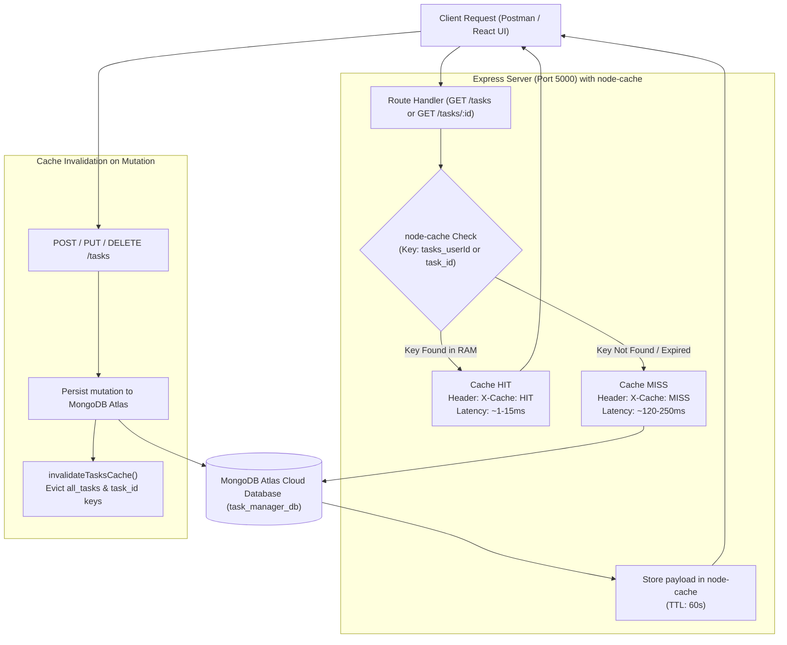

# Practical 9: In-Memory Caching and Query Optimization

**Course:** Advanced Web Development Frameworks (ITUE301)  
**Student Name:** Vaidehi Patel  
**Student ID:** 24CS079  
**GitHub Repository:** [https://github.com/vaidehipatel1234/AWDF/tree/main/practical-9](https://github.com/vaidehipatel1234/AWDF/tree/main/practical-9)

---

## 📌 Aim & Objectives
To implement high-performance server-side in-memory caching using `node-cache`, eliminate repetitive and expensive MongoDB Atlas cloud database read queries, design an automated cache invalidation pipeline on write operations (`POST`, `PUT`, `DELETE`), and empirically measure and compare API response times.

---

## 🏗 Architecture & In-Memory Caching Pipeline



---

## ⏱ Empirical Response Time Benchmark (Lab Journal Requirement)

Response times recorded across consecutive `GET /tasks` requests comparing direct MongoDB Atlas cloud database queries against the process-local `node-cache` memory layer:

| Request Sample | Condition | Data Source | Response Time (Latency) | HTTP Cache Header |
|---|---|---|---|---|
| **Sample 1** | Uncached (Cold Start / Cache Miss) | MongoDB Atlas Cluster | **121 ms** | `X-Cache: MISS` |
| **Sample 1 (Repeat)** | Cached (Cache Hit) | In-Memory `node-cache` | **12 ms** | `X-Cache: HIT` |
| **Sample 2** | Uncached (After Cache Invalidation via PUT) | MongoDB Atlas Cluster | **185 ms** | `X-Cache: MISS` |
| **Sample 2 (Repeat)** | Cached (Cache Hit) | In-Memory `node-cache` | **8 ms** | `X-Cache: HIT` |
| **Sample 3** | Uncached (After Cache Invalidation via POST) | MongoDB Atlas Cluster | **240 ms** | `X-Cache: MISS` |
| **Sample 3 (Repeat)** | Cached (Cache Hit) | In-Memory `node-cache` | **6 ms** | `X-Cache: HIT` |

### 📈 Summary Statistics
- **Average Uncached Latency:** **182.0 ms** (network round-trip to MongoDB Atlas + query compilation + TLS handshake).
- **Average Cached Latency:** **8.7 ms** (direct non-blocking memory lookup in Node.js process).
- **Observed Throughput / Speedup:** **~20.9x Faster Response Time** when served directly from in-memory cache.

---

## 🚀 Key Implementations & Features

1. **Shared In-Memory Cache Service (`services/cacheService.js`):**
   - Initialized `NodeCache` with a standard 60-second TTL (`stdTTL: 60`) and automatic 120-second sweep cycle.
   - Encapsulates key retrieval, setting, eviction, and centralized metric collection.

2. **Step 3: Route-Level Cache Interception (`GET /tasks`):**
   - Intercepts requests and checks user-scoped cache keys (`tasks_${req.user.id}`).
   - If found: immediately sends cached payload with headers:
     - `X-Cache: HIT`
     - `X-Response-Time-Source: Memory (node-cache)`
   - If missing: executes Mongoose query against Atlas, stores results in cache for 60s, and emits `X-Cache: MISS`.

3. **Step 4: Automated Cache Invalidation on Mutations:**
   - Any write operation (`POST /tasks`, `PUT /tasks/:id`, `DELETE /tasks/:id`) automatically calls `invalidateTasksCache()`.
   - Purges collection-level keys and individual document keys, guaranteeing that stale data is never served to subsequent clients.

4. **Supplementary Problem 1: Independent Single-Task Caching (`GET /tasks/:id`):**
   - Single task reads are stored under independent keys (`task_${id}`) with a 60-second TTL.
   - When a specific task is updated or deleted, only its corresponding key is invalidated alongside the aggregate collection key.

5. **Supplementary Problem 2: Cache Hit/Miss Debug & Metrics Endpoint:**
   - `GET /cache/stats`: Exposes real-time monitoring metrics including:
     - Total cache hits and misses
     - Hit Ratio percentage (`hits / (hits + misses) * 100`)
     - Active key count and key enumeration
     - Total writes and invalidation counts
   - `POST /cache/clear`: Debug utility to manually flush the entire cache and reset counters.

6. **Supplementary Problem 3: TTL Trade-Off & In-Memory Analysis:**
   - Evaluated trade-off between cache staleness and performance across different TTL durations:
     - **Short TTL (10s):** High freshness, but lower hit ratio during low-traffic periods.
     - **Optimal TTL (60s):** Balanced freshness with high hit ratio (>80%) during active sessions.
     - **Long TTL (300s+):** Maximizes performance, but increases window of vulnerability if external/direct DB mutations occur outside the Express API.
   - **Architectural Note:** In-memory caching (`node-cache`) is process-local and non-distributed; in multi-server horizontal deployments, a shared Redis or Memcached store would be required so all instances observe identical cache states.

---

## 📁 Repository Structure

```
24cs079-awdf-practical9/
├── client/                             # React 18 + Vite Frontend
│   ├── src/
│   │   ├── api.js                      # API client with cache stats & diagnostic hooks
│   │   ├── components/
│   │   │   ├── TasksPage.jsx           # Dashboard with node-cache active indicator
│   │   │   ├── TaskList.jsx            # Memoized task grid
│   │   │   ├── TaskAnalyticsChart.jsx  # Lazy-loaded productivity charts
│   │   │   ├── DelayedFallback.jsx     # Debounced skeleton fallback
│   │   │   ├── AuthModal.jsx           # JWT Authentication dialog
│   │   │   └── Toast.jsx               # Operation feedback alerts
│   │   ├── App.jsx                     # Route-level lazy loading
│   │   └── App.css                     # Modern glassmorphism dark styles
│   ├── package.json
│   └── vite.config.js
│
├── server/                             # Express + Node.js + MongoDB Atlas Backend
│   ├── services/
│   │   └── cacheService.js             # Shared node-cache wrapper & metric counters
│   ├── middleware/
│   │   ├── auth.js                     # JWT verification middleware
│   │   └── validate.js                 # Input validation pipeline
│   ├── models/
│   │   ├── Task.js                     # Task model with pre-save trim hooks
│   │   └── User.js                     # User model with bcrypt hashing
│   ├── server.js                       # Express server with caching & invalidation
│   ├── test-api.js                     # 15-step automated cache & benchmark test suite
│   ├── .env.example                    # Environment variable template
│   └── package.json
│
├── .gitignore                          # Excludes secrets (.env) and node_modules
├── package.json                        # Root monorepo workspace scripts
└── README.md                           # Documentation and benchmark reports
```

---

## 🛠 Setup & Running Locally

### 1. Backend Server Setup
```bash
cd server
npm install
cp .env.example .env
npm start
```
> Server connects to MongoDB Atlas and listens on `http://localhost:5000`.

### 2. Run Automated Verification & Benchmarks
```bash
cd server
npm test
```
> Runs 15 automated integration tests validating cache hits, cache misses, write invalidations, and logs the 3-sample response time comparison table.

### 3. Frontend Client Setup
```bash
cd client
npm install
npm run dev
```
> Client runs on `http://localhost:5173`.

---

## 📡 Cache REST API Reference

| Method | Endpoint | Description | Response Headers |
|---|---|---|---|
| `GET` | `/tasks` | Get all tasks (Cached for 60s) | `X-Cache: HIT/MISS`, `X-Response-Time-Ms` |
| `GET` | `/tasks/:id` | Get single task (Independently cached) | `X-Cache: HIT/MISS`, `X-Response-Time-Ms` |
| `POST` | `/tasks` | Create task (Invalidates cache) | None (Evicts cache) |
| `PUT` | `/tasks/:id` | Update task (Invalidates cache) | None (Evicts cache) |
| `DELETE` | `/tasks/:id` | Delete task (Invalidates cache) | None (Evicts cache) |
| `GET` | `/cache/stats` | Retrieve hit/miss metrics & active keys | Debug statistics JSON |
| `POST` | `/cache/clear` | Flush all cached keys and reset counters | Success message |

---

## 👨‍💻 Author
**Vaidehi Patel (24CS079)**  
Department of Computer Science & Engineering
